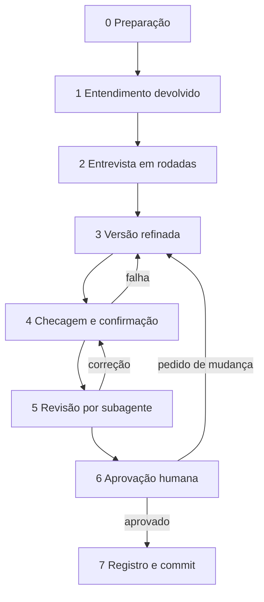

# Por que o harness é assim

Aqui estão os porquês e os limites; para usar: [tutorial](tutorial.md), [guias](guias.md) e [referência](referencia.md).

## Sete escolhas

1. **Camadas com gate que só o humano aprova.** Uma camada só começa depois de o humano aprovar, na conversa, o gate da
   anterior, e assim parte de base firme. Aprovar um documento autoriza o commit dele, não o próximo nem o gate.
2. **Um ciclo fixo com três papéis.** O modelo escreve, um subagente em contexto novo revisa e só o humano aprova e pede
   commit, porque quem avalia o próprio texto tende a elogiá-lo. Skill de terceiros não substitui o ciclo.
3. **O estado em disco, porque a conversa se perde.** Ela some no `/clear` e na sessão nova e encolhe na compactação; o
   `STATUS.md` guarda fase, documento, passo e rodada, e um hook o injeta no início de cada sessão.
4. **Script no que é verificável.** Um script acha placeholder, título fora do molde, ID repetido e versão mudada depois
   da aprovação, sem depender do modelo. Dúvida que muda o escopo vira pergunta; a menor, `[A CONFIRMAR]`.
5. **Núcleo e perfil.** O `.claude/perfil.toml` adapta o núcleo ao projeto e não muda o ciclo de oito passos, os campos
   do STATUS, a marca `[A CONFIRMAR`, as tabelas do backlog, as verificações de gate nem os blocos das três skills.
6. **Guardas, porque o `CLAUDE.md` orienta mas não impõe.** O `deny` e os hooks barram a edição à mão dos moldes e do
   `STATUS.md`, a linha tirada das decisões e a mudança no documento em aprovação; pre-commit e CI conferem invariantes.
7. **A passagem sai de um commit.** O disco tem o que ainda não foi aprovado; a legenda é gerada e conferida no commit.

## O ciclo de um documento

## O lote e o migrar

**O lote.** Uma pendência pode pedir mudança em vários aprovados, de camadas diferentes. Em vez de um ciclo por
documento, o lote os revisa juntos: uma pendência, várias camadas, uma checagem, um revisor por camada e um só
"aprovado". Antes dele, o resumo por mudança diz o que mudou em cada documento, com a legenda dos IDs.

**O migrar.** Quando a forma dos documentos muda numa versão, `harness.py migrar` a corrige por script, sem o modelo, e
abre um lote com os documentos corrigidos: começa na checagem, tem um revisor com o critério forma e um só "aprovado", e
os documentos mantêm o status e a data de aprovação. O que o script não corrige fica como está e sai como aviso; sem
nada a corrigir, ele só registra a migração. A verificação nova só avisa no aprovado antes da migração que a trouxe.

## Limitações

- **Uma pessoa por vez.** O `STATUS.md` acompanha um documento ou um pacote, e duas sessões simultâneas o disputam.
- **CI que só informa.** Sem proteção de branch, um check vermelho não impede o merge.
- **Guarda que lê só o texto do comando.** `eval` e script em arquivo passam; o hook Stop só confere as invariantes.
- **Plugin e pre-commit ativados em cada clone.** O plugin instala por pasta (`--scope project`), e o pre-commit só roda depois de `git config core.hooksPath .githooks`; o `--no-verify` o pula.
- **Regras pela pasta do arquivo lido.** As de `.claude/rules/` entram pelo `paths`; YAML inválido as liga sempre.
- **Node e bancos fora do `harness.py`.** Ficam em `nucleo/planejamento/ferramentas/`, no plugin: o validador Mermaid roda na CI e, com Node, local; os bancos, só na CI.

O núcleo pede ao Claude Code, ou a um equivalente: hooks `SessionStart` e `PreToolUse` com matcher, `UserPromptSubmit` e
`Stop`; `` !`...` ``, `$ARGUMENTS` e `${CLAUDE_PROJECT_DIR}` no `SKILL.md`; `disable-model-invocation`, `allowed-tools`,
`tools` e `model`; subagente em segundo plano e `TaskStop`; `permissions.deny` e `permissions.ask`; `skillOverrides`; `.claude/rules/` com `paths`.
