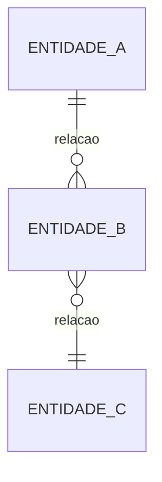

# Modelo Conceitual — {{PROJETO}}

> FIM DA CAMADA INTERMEDIÁRIA · ponte para o Avançado.
> Entidades e relações **sem tipo de coluna, sem PK/FK, sem banco específico**.
> Ainda é domínio, não banco. O modelo FÍSICO (com tipos, índices) vem no
> Avançado, depois de escolher o banco. Separar os dois evita modelar tabela
> antes de entender a entidade.

---

## Entidades e relações
<!-- Liste as entidades e como se ligam. Pode escrever em texto e/ou Mermaid.
     Mermaid ER (relações conceituais, sem tipos):

     Ajuste para o domínio real do {{PROJETO}}. -->

## Glossário
<!-- Termo do domínio → definição. Resolve ambiguidades. -->

| Termo | Definição |
|---    |---        |
|       |           |
