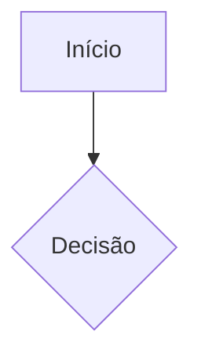

# Fluxos de UI/UX — {{PROJETO}}

> CAMADA AVANÇADA · jornadas em fluxograma (seu Avançado item 1, continuação).
> Só vira fluxo o que tem ramificação, máquina de estados ou troca de ator; cadastro simples é tela.

---

## Critério e lista
<!-- Os fluxos deste documento, um por linha, com o motivo de cada um virar fluxo. -->

-

## Fluxo: <!-- nome -->
<!-- Atores, telas (links para os tela-*.md) e requisitos que o fluxo atravessa. -->

- Atores:
- Telas:
- Requisitos:

