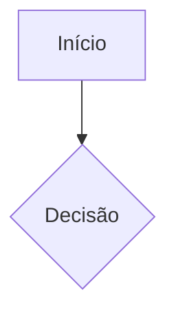

# Modelo Físico & Diagramas — {{PROJETO}}

> CAMADA AVANÇADA · primeiras representações visuais dos requisitos (seu Avançado item 1).
> **Não** é a diagramação final geral — é a primeira tradução visual do que foi levantado.

---

## Nota de nomenclatura
<!-- O que você chamou de "ERP do banco" é, no mercado, DER (Diagrama Entidade-
     Relacionamento) ou ER diagram. ERP é outra coisa (sistema de gestão, tipo SAP).
     Aqui é DER FÍSICO: com tipos do banco escolhido, PK/FK, índices. Difere do
     modelo conceitual (camada Intermediária), que não tinha tipos. -->

## DER físico
<!-- Agora com tipo de coluna, PK, FK, índices. Defina chaves, timestamps padrão,
     soft delete, ENUMs e política de FK.
     Ferramenta: Mermaid para versionar, ou draw.io para visual. -->

```mermaid
erDiagram
    %% adicione tipos: int, varchar(n), etc.
```

## Protótipos de tela
<!-- Primeiras telas a partir dos fluxos.
     Ferramenta: Figma. Linke os frames aqui. -->

- Link/figura:

## Fluxos de UI/UX
<!-- Jornada do usuário em fluxograma. Ferramenta: Mermaid (flowchart) ou draw.io. -->



## Diagrama de arquitetura de aplicação
<!-- Como o backend se organiza em camadas e como o frontend consome. -->


## Diagrama de arquitetura em nuvem
<!-- Compute, banco, armazenamento de arquivos, CDN, rede. Ferramenta: draw.io.
     Custo: calculadora de preços do provedor escolhido. -->

- Diagrama:
- Estimativa de custo:

---

## Ordem de produção nesta camada
<!-- Sugestão: conceitual já existe → físico → fluxos → protótipos → arquitetura app
     → arquitetura nuvem. Visual depende do que veio antes. -->
